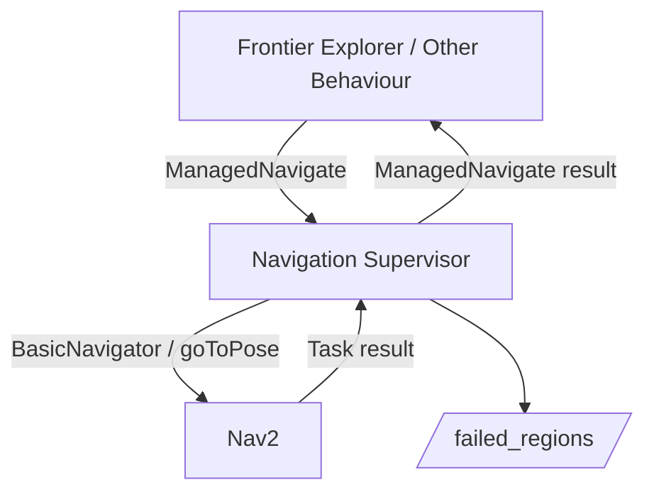

# Navigation Supervisor

ROS 2 navigation supervision package for the METR4202 autonomous search project.

The Navigation Supervisor provides a single managed navigation interface between
other modules, such as the Frontier Explorer, and Nav2. It accepts
navigation requests through the custom `ManagedNavigate` action, validates them,
executes them using Nav2 Simple Commander, reports the final outcome, and records
locations where Nav2 ultimately fails.

The package is currently implemented and tested using ROS 2 Humble, Python,
Nav2, SLAM Toolbox, Gazebo, and TurtleBot3 Waffle/Waffle Pi.

## Architecture



## ManagedNavigate Action

The external navigation interface is:

```text
/managed_navigate
```

using:

```text
navigation_interfaces/action/ManagedNavigate
```

### Goal

```text
geometry_msgs/PoseStamped target_pose
```

The supervisor currently requires the goal to:

- be a `PoseStamped`;
- use the configured global frame, normally `map`;
- contain only finite position and orientation values;
- contain a non-zero quaternion.

Valid quaternions are normalised before the pose is sent to Nav2.

### Result

The action defines the following result codes:

| Code | Result | Current support |
|---:|---|---|
| 0 | `SUCCEEDED` | Implemented |
| 1 | `BLACKLISTED` | Reserved for interface compatibility |
| 2 | `PLANNING_FAILED` | Reserved for future detailed failure classification |
| 3 | `NAVIGATION_FAILED` | Implemented |
| 4 | `STUCK` | Reserved for future progress/stuck detection |
| 5 | `CANCELED` | Implemented |
| 6 | `INVALID_GOAL` | Implemented |
| 7 | `INTERNAL_ERROR` | Implemented |

The result also contains:

```text
string message
bool failed_region_recorded
```

`failed_region_recorded` is set when an actual completed Nav2 navigation attempt
returns failure and the goal location is stored in the failed region history.

At present, Nav2 Simple Commander reliably exposes the final task as
`SUCCEEDED`, `CANCELED`, or `FAILED`. A generic final Nav2 failure is
currently reported as `NAVIGATION_FAILED`.

More detailed classification into `PLANNING_FAILED`, `STUCK`, and other failure
types is planned for later development.

### Feedback

`ManagedNavigate.action` defines feedback fields for:

- navigation state;
- distance remaining;
- navigation time;
- recovery count.

These fields are reserved for later supervisory functionality and are not
currently published by the Navigation Supervisor.

## Goal Execution

A normal request follows this sequence:

```text
ManagedNavigate goal
        |
        v
Validate target_pose
        |
        v
Queue validated goal
        |
        v
BasicNavigator.goToPose()
        |
        v
Nav2 planning / control / recovery
        |
        v
Simple Commander task result
        |
        v
ManagedNavigate result
```

## Cancellation

A `ManagedNavigate` cancellation request is accepted for the active navigation
request.

The action cancellation callback only records that cancellation has been
requested. The actual call to Nav2 `cancelTask()` is performed by the
supervisor's update loop rather than directly inside the action callback.


A successful cancellation returns:

```text
CANCELED
```

and does not create a failed region.

## Failed Regions

Actual final Nav2 navigation failures are recorded and published on:

```text
/failed_regions
```

using:

```text
navigation_interfaces/msg/FailedRegionArray
```

Each region stores:

- a unique region ID;
- centre position;
- radius;
- failure count;
- most recent failure reason;
- first failure time;
- most recent failure time.

The default region radius is:

```text
0.30 m
```

Failures close to an existing failed region are merged into that region and its
failure count is incremented.

### Failed regions are not a blacklist

The supervisor doesn't reject a new navigation request because its target
lies inside a previously failed region.

For Stage 1, Frontier Explorer subscribes to `/failed_regions` and decides how
previous failures affect frontier selection. Another behaviour may choose a
different policy and may still request navigation to the same location.

The topic therefore represents:

> Locations where Nav2 was actually asked to navigate and ultimately failed.

### QoS

`/failed_regions` uses:

- `RELIABLE`;
- `TRANSIENT_LOCAL`;
- depth 1.

The complete current failed region history is published as one array, allowing
late subscribers to receive the latest state while the Navigation Supervisor is
running.

Failed region history is currently stored in memory and is reset when the node
is restarted.

## Frontier Explorer Integration

The Stage 1 navigation path is:

```text
Frontier Explorer
    |
    | ManagedNavigate
    v
Navigation Supervisor
    |
    | Nav2 Simple Commander
    v
Nav2
```

## Parameters

| Parameter | Default | Description |
|---|---|---|
| `global_frame` | `map` | Required frame for incoming navigation goals |
| `managed_navigate_action` | `managed_navigate` | ManagedNavigate action server name |
| `failed_region_radius` | `0.30` | Radius used to group failed navigation locations |
| `failed_regions_topic` | `/failed_regions` | Topic used to publish failed-region history |

## Package Structure

```text
navigation_supervisor/
├── navigation_supervisor/
│   ├── navigation_supervisor.py
│   ├── failed_region_manager.py
│   ├── navigation_types.py
│   └── __init__.py
├── test/
├── package.xml
├── setup.py
└── README.md
```

### `navigation_supervisor.py`

Implements:

- the `ManagedNavigate` action server;
- goal validation;
- the navigation state machine;
- Nav2 Simple Commander interaction;
- cancellation;
- result mapping;
- failed region publication.

### `failed_region_manager.py`

Stores failed navigation regions and merges repeated failures occurring within
an existing region.

### `navigation_types.py`

Contains internal navigation states, outcomes, failure reasons, and supporting
data structures.

## Build

From the project workspace:

```bash
source /opt/ros/humble/setup.bash

colcon build \
    --packages-select navigation_interfaces navigation_supervisor \
    --symlink-install

source install/setup.bash
```

## Run

With Nav2 and the required localisation/SLAM system already running:

```bash
source /opt/ros/humble/setup.bash
source install/setup.bash

ros2 run navigation_supervisor navigation_supervisor
```

For Gazebo simulation:

```bash
ros2 run navigation_supervisor navigation_supervisor \
    --ros-args -p use_sim_time:=true
```

The Nav2 parameters installed with this package treat unknown costmap cells as
traversable, allowing navigation through unmapped holes during exploration.

## Inspect the Action Server

```bash
ros2 action info /managed_navigate
```

or:

```bash
ros2 action list -t
```

## Example Navigation Goal

```bash
ros2 action send_goal \
    /managed_navigate \
    navigation_interfaces/action/ManagedNavigate \
    "{target_pose: {header: {frame_id: 'map'}, pose: {position: {x: 2.0, y: 0.0, z: 0.0}, orientation: {w: 1.0}}}}"
```

A successful request returns:

```text
result_code: 0
message: Navigation succeeded.
failed_region_recorded: false
```

## Inspect Failed Regions

```zsh
ros2 topic echo /failed_regions \
    navigation_interfaces/msg/FailedRegionArray \
    --qos-reliability reliable \
    --qos-durability transient_local \
    --qos-history keep_last \
    --qos-depth 1
```

## Current Limitations and Planned Work

Planned extensions include:

- distinguishing planning failures from generic Nav2 failures;
- detecting sustained lack of progress and returning `STUCK`;
- using Nav2 feedback for distance remaining and navigation time;
- publishing `ManagedNavigate` feedback;
- recording recovery counts;
- more detailed internal failure reasons;
- Stage 2 behaviours using the same `ManagedNavigate` interface.
